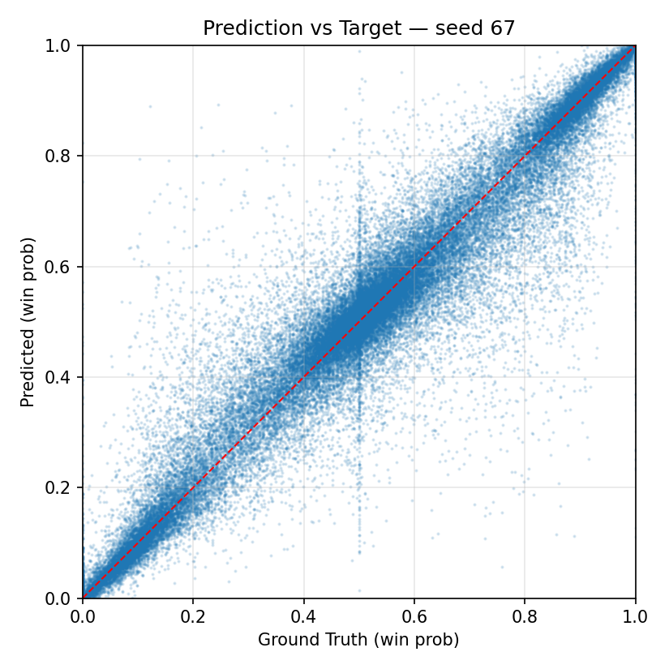

# Chess Transformer

A small encoder-only transformer that looks at a chess position and predicts Stockfish's win probability for white, without any search. Trained on 10 million positions per run from DeepMind's [ChessBench](https://github.com/google-deepmind/searchless_chess) dataset, it reaches a Pearson correlation of 0.96 with Stockfish on held-out positions and plays at roughly 1,270 Elo against strength-limited Stockfish.

  

**[Read the report (PDF)](docs/report.pdf)**, *Exploring positional chess encodings for transformer-based learning*.

## What the project explores

How much does the way you **encode the board** matter? Three encoders of increasing richness were compared, each trained with three seeds on disjoint data splits.

| Encoder | Input | Pearson r | MAE | Sign accuracy | Playing strength (Elo) |
|---|---|---|---|---|---|
| `piece_plane` | 19 planes. Pieces, side to move, castling, en passant | 0.927 | 0.060 | 87.8% | well below 1,320 |
| `dynamic_piece_plane` | 31 planes. Adds attack and defence maps, reachability, pins, check | **0.960** | **0.045** | **90.2%** | **~1,270** |
| `full_piece_plane` | 37 planes. Adds pawn structure (doubled, isolated, passed) | not run | not run | not run | ~1,240 |

Values are means over three seeds on a shared test set of 62,829 positions. Playing strength was estimated from 140 games per model against Stockfish limited to 1,320 to 2,500 Elo, fitted with the standard Elo model.

**Takeaway.** The plain piece encoding already predicts evaluations well, yet it plays very poorly. Adding tactical information (what attacks and defends what) improves prediction a little and playing strength a lot. Pawn-structure planes on top of that did not help further.

## How it works

- **Model.** Each of the 64 squares becomes a token. A 5-layer transformer (d_model 128, 4 heads, pre-norm, GELU) is followed by mean pooling and a sigmoid head that outputs P(white wins).
- **Training.** AMP, cosine learning-rate schedule, early stopping and gradient clipping, with batch size 4,096 and a learning-rate and dropout grid search on a separate tuning split.
- **Evaluation.** MSE, MAE, Pearson, Spearman and sign accuracy on a held-out test set, plus Elo estimation from games against Stockfish.
- **Play it.** A pygame GUI lets you play against any trained model, with an evaluation bar and the bot's top five candidate moves.

## Get started

Installation, data download, training, evaluation and the GUI are described in [SETUP.md](SETUP.md). Pretrained checkpoints are on the [releases page](https://github.com/LucasKuszli/chess-transformer/releases).

Built with Python, PyTorch, python-chess and pygame.
